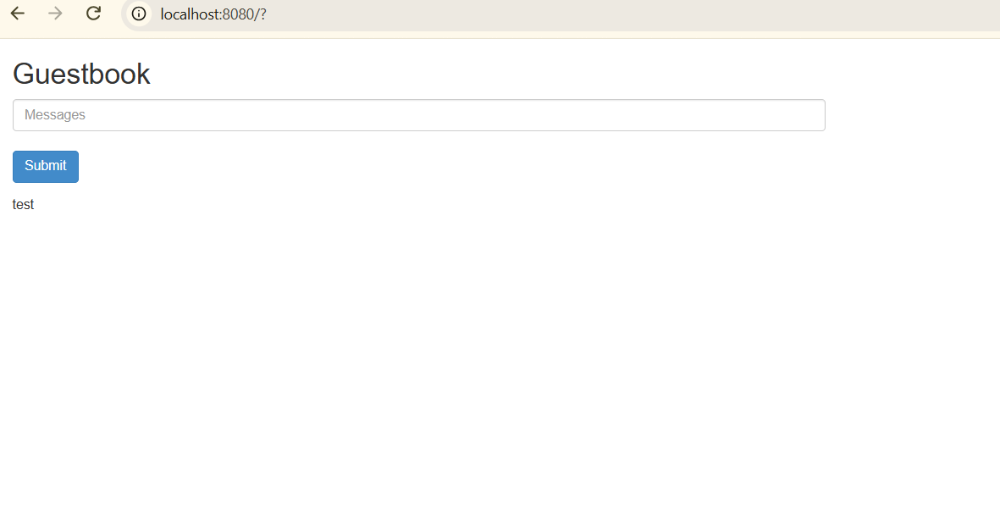
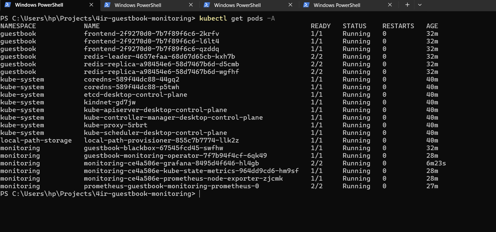
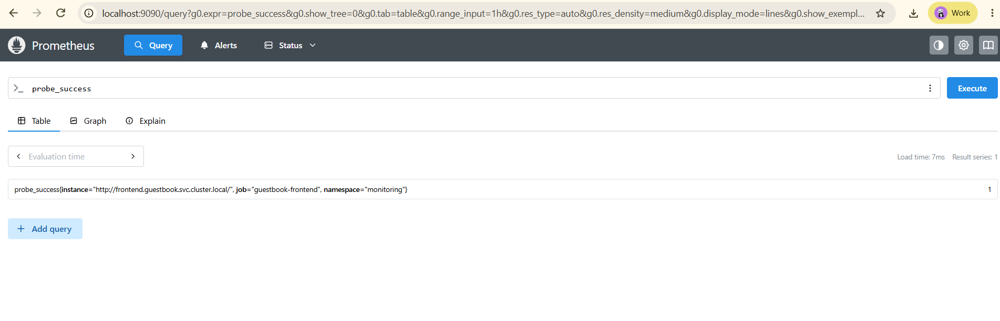
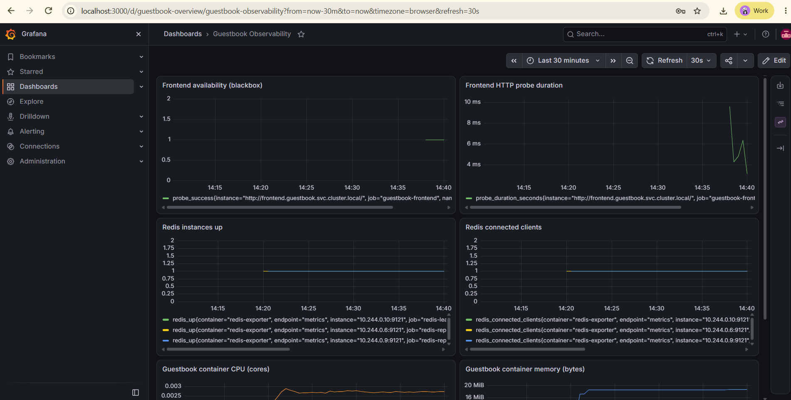

# 4IR Solutions — Guestbook Observability

Infrastructure as Code implementation of a Kubernetes Guestbook application with Prometheus, Grafana, Redis Exporter, and Blackbox Exporter, using Pulumi and TypeScript.

This project extends the architecture of the official [Pulumi TypeScript Guestbook](https://github.com/pulumi/examples/tree/master/kubernetes-ts-guestbook).

## Architecture

The application and monitoring infrastructure are deployed using Pulumi.

### Application components

- PHP Guestbook frontend — 3 replicas
- Redis leader — 1 replica
- Redis replicas — 2 replicas
- Redis Exporter — sidecar containers for Redis metrics

### Monitoring components

- Prometheus — metrics collection and querying
- Prometheus Operator — ServiceMonitor and Probe discovery
- Blackbox Exporter — frontend HTTP availability and latency
- Grafana — dashboards and visualization
- kube-state-metrics and node-exporter — Kubernetes monitoring

### Monitoring flow

```text
                  Kubernetes Cluster
                         |
          +--------------+--------------+
          |                             |
     guestbook namespace          monitoring namespace
          |                             |
     PHP Frontend (3)                Prometheus
          |                             |
     Redis Leader (1)         +---------+---------+
          |                   |                   |
     Redis Replicas (2)   ServiceMonitor         Probe
          |                   |                   |
     Redis Exporters <--------+              Blackbox Exporter
                                                  |
                                           HTTP Guestbook
                                               Frontend

                         Grafana
                            |
                        Prometheus
                            |
                    Monitoring Dashboard
```

## Prerequisites

- Node.js 20+ and npm
- Pulumi CLI
- kubectl
- Kubernetes cluster (Docker Desktop Kubernetes, kind, Minikube, or a managed Kubernetes service)
- Network access to container registries and Helm repositories
- Permissions to deploy Helm charts and install Kubernetes CRDs
- Sufficient CPU and memory for the application and monitoring stack

The implementation was tested on Docker Desktop Kubernetes.

## Project Structure

```text
4ir-guestbook-monitoring/
├── index.ts
├── dashboard.json
├── Pulumi.yaml
├── package.json
├── package-lock.json
├── tsconfig.json
├── .gitignore
├── README.md
└── screenshots/
    ├── grafana-dashboard.png
    ├── guestbook-app.png
    ├── kubernetes-pods.png
    └── prometheus-probe-success.png
```

## Deployment

### 1. Install dependencies

```bash
npm install
npm run check
```

### 2. Initialize Pulumi

```bash
pulumi login --local
pulumi stack init dev
```

If the `dev` stack already exists, select it instead:

```bash
pulumi stack select dev
```

### 3. Configure Grafana

Set the Grafana administrator password as a Pulumi secret:

```bash
pulumi config set --secret grafanaAdminPassword
```

Enter a strong password when prompted.

Configure Grafana access:

```bash
pulumi config set grafanaServiceType NodePort
```

For a cloud environment supporting LoadBalancer services:

```bash
pulumi config set grafanaServiceType LoadBalancer
```

### 4. Deploy the infrastructure

```bash
pulumi preview
pulumi up
```

Confirm the deployment when prompted.

Pulumi creates the application and monitoring namespaces, Guestbook workloads, Redis Exporters, Prometheus/Grafana Helm stack, Blackbox Exporter, ServiceMonitor, and HTTP Probe.

## Access the Application

### Guestbook

Run:

```bash
kubectl -n guestbook port-forward svc/frontend 8080:80
```

Open:

http://localhost:8080

Add a Guestbook entry to verify that the frontend and Redis backend are operational.

### Grafana

Discover the Grafana service:

```bash
kubectl -n monitoring get svc -l app.kubernetes.io/name=grafana
```

In the tested deployment, the generated service name was:

```text
monitoring-ce4a506e-grafana
```

Start port-forwarding:

```bash
kubectl -n monitoring port-forward svc/monitoring-ce4a506e-grafana 3000:80
```

If Helm generates a different Grafana service name, replace `monitoring-ce4a506e-grafana` with the name returned by the service lookup command.

Open:

http://localhost:3000

Sign in with username `admin` and the Grafana password configured through Pulumi.

The provisioned dashboard is available under:

**Dashboards → Guestbook Observability**

For NodePort deployments, port `30030` can also be used when the cluster node is reachable.

Do not expose Grafana publicly without appropriate authentication, TLS, and network controls.

### Prometheus

Run:

```bash
kubectl -n monitoring port-forward svc/guestbook-monitoring-prometheus 9090:9090
```

Open:

http://localhost:9090

To inspect scrape targets:

http://localhost:9090/targets

## Monitoring and Metrics

### Frontend availability

The Blackbox Exporter performs HTTP checks against:

```text
http://frontend.guestbook.svc.cluster.local/
```

Prometheus discovers the custom Probe resource `guestbook-frontend`.

Useful queries:

```promql
probe_success
```

```promql
probe_duration_seconds
```

A `probe_success` value of `1` indicates a successful HTTP probe.

### Redis monitoring

Redis Exporter sidecars expose metrics on port `9121`.

Prometheus discovers the exporters through the `guestbook-redis` ServiceMonitor.

Useful queries:

```promql
redis_up
```

```promql
redis_connected_clients
```

The tested deployment reported three Redis metric series: one leader and two replicas.

### Kubernetes resource monitoring

The Grafana dashboard includes CPU and memory usage panels for Guestbook containers.

These panels depend on kubelet/cAdvisor metrics being available in the target Kubernetes cluster.

### Application instrumentation limitation

The stock Guestbook frontend does not expose native Prometheus HTTP request counters.

This implementation therefore monitors actual frontend availability and HTTP probe duration rather than claiming application request rates or error rates that are not instrumented.

Adding application-level HTTP instrumentation would enable request throughput, error-rate, and latency SLIs in a future enhancement.

## Verification

Check application pods:

```bash
kubectl get pods -n guestbook
```

Check monitoring pods:

```bash
kubectl get pods -n monitoring
```

Verify the Redis ServiceMonitor:

```bash
kubectl -n monitoring get servicemonitor guestbook-redis
```

Verify the HTTP Probe:

```bash
kubectl -n monitoring get probe guestbook-frontend
```

Verify Prometheus:

```promql
probe_success
redis_up
redis_connected_clients
```

The tested deployment confirmed:

- Guestbook frontend accessible and able to accept entries
- Redis leader and replicas running
- Redis Exporter metrics available in Prometheus
- HTTP blackbox probe returning `probe_success = 1`
- Grafana dashboard provisioned successfully
- Live frontend availability, HTTP probe duration, Redis, CPU, and memory graphs

## Verification Screenshots

Evidence from the Docker Desktop Kubernetes deployment is included in the `screenshots/` directory.

### Guestbook Application



### Kubernetes Workloads



### Prometheus HTTP Probe



### Grafana Dashboard



## Troubleshooting

### Pods are pending

Check cluster resources and pod events:

```bash
kubectl describe pod -n monitoring <POD_NAME>
```

### ImagePullBackOff

Check container registry access and image availability:

```bash
kubectl get pods -A
```

Inspect the affected pod with `kubectl describe pod`.

### Redis metrics missing

Check Redis Exporter sidecars, metrics services, and the ServiceMonitor:

```bash
kubectl -n guestbook get svc
kubectl -n monitoring get servicemonitor guestbook-redis
```

### Frontend probe missing

Verify the Probe and Blackbox Exporter:

```bash
kubectl -n monitoring get probe guestbook-frontend
kubectl -n monitoring get svc guestbook-blackbox
```

Check Prometheus Probe discovery selectors if the Probe exists but no metrics are returned.

### Grafana dashboard missing

Inspect the Helm-managed dashboard ConfigMap, Grafana dashboard provider configuration, and Grafana logs.

### Grafana NodePort inaccessible

Use Kubernetes port-forwarding. NodePort reachability depends on the cluster's networking configuration.

### CPU or memory panels have no data

Verify that kubelet/cAdvisor metrics are being collected.

## Security Considerations

- Grafana administrator password is stored using Pulumi secret configuration.
- Secrets are not hard-coded into the source.
- Local Pulumi stack configuration and state are excluded from Git.
- Grafana and Prometheus access is intended for development and testing.
- Production deployments should implement TLS, authentication, persistent storage, RBAC hardening, network policies, and monitoring availability controls.

## Cleanup

To remove deployed infrastructure:

```bash
pulumi destroy
```

To remove the local Pulumi stack after destroying resources:

```bash
pulumi stack rm dev
```

**Warning:** These commands remove infrastructure. Do not execute them while the deployment is needed for assessment review.

## Notes for Reviewers

- Infrastructure and monitoring resources are managed declaratively through Pulumi TypeScript.
- The application runs in the `guestbook` namespace.
- The observability stack runs in the `monitoring` namespace.
- Redis Exporters provide Redis availability and client metrics.
- Blackbox Exporter monitors frontend HTTP availability and response time.
- Grafana dashboard configuration is version-controlled in `dashboard.json`.
- Verification screenshots demonstrate the working deployment.
- This is a technical assessment implementation, not a production-hardened deployment.
